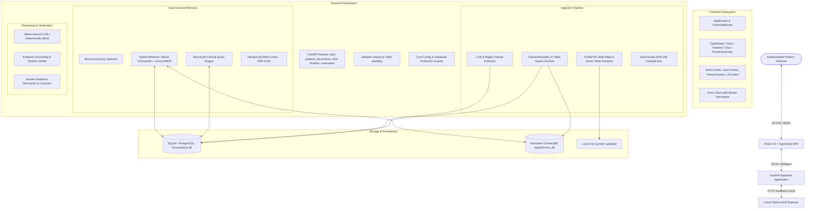
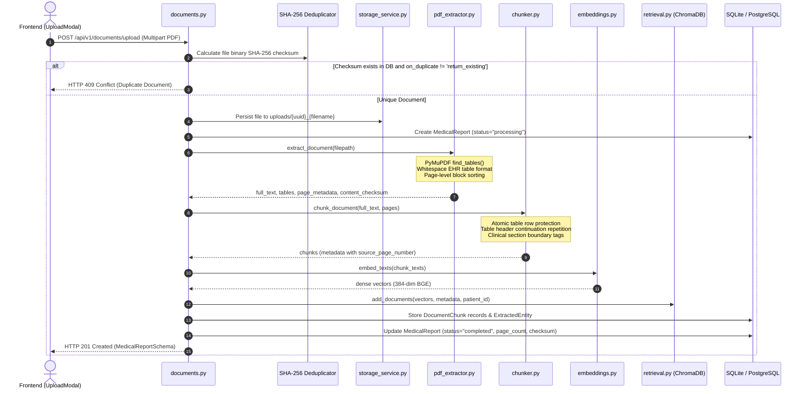
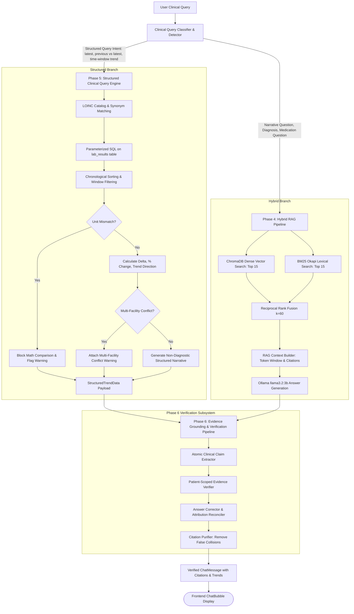

# System Architecture — ChronaNexus

## 1. High-Level Architectural Paradigm

ChronaNexus is built as a **privacy-first, dual-channel clinical intelligence architecture**. It deliberately separates:
1. **Deterministic Structured Data Processing**: Relational SQL tables for patients, diagnoses, medications, laboratory measurements, allergies, and timeline encounters.
2. **Dense & Lexical Vector RAG**: ChromaDB dense vector embeddings (`bge-small-en-v1.5`) combined with BM25 Okapi lexical ranking and Reciprocal Rank Fusion (RRF) for unstructured clinical prose and document passages.
3. **Claim-Level Evidence Grounding**: An in-tree validation layer that decomposes generated answers into atomic assertions and verifies every factual statement against authoritative patient records before returning to the user.

---

## 2. Ingestion & Document Processing Pipeline (System 1 & 2)

When a document is uploaded through `POST /api/v1/documents/upload`, the application executes a complete multi-stage pipeline:

---

## 3. Dual-Channel Clinical Retrieval & Evidence Grounding (System 5)

When a query is submitted through `POST /api/v1/chat/conversations/{id}/messages`, the system routes between structured SQL aggregation and hybrid RAG:

---

## 4. Key Subsystem Interfaces & Protocols

| Subsystem | Primary Interface File | Input Protocol | Output Protocol | Persistence Target |
|---|---|---|---|---|
| **REST API** | `backend/app/main.py` | HTTP/1.1 JSON, Multipart Form | JSON Pydantic Schemas | SQLite / PostgreSQL |
| **Document Storage** | `backend/app/services/storage_service.py` | Raw Byte Stream | UUID-prefixed file on disk | `uploads/` |
| **Relational DB** | `backend/app/core/database.py` | SQLAlchemy ORM Sessions | Python Models / Row Tuples | `chronanexus.db` |
| **Vector DB** | `backend/app/ai/retrieval.py` | 384-dim Floats + Metadata Dict | Ranked Document Chunks | `data/chroma_db/` |
| **Local LLM** | `backend/app/ai/llm/ollama_provider.py` | Prompt Strings via HTTP POST | Streamed / Chunked Text | `http://localhost:11434` |
| **Dense Embedder** | `backend/app/ai/embeddings.py` | Normalized Text Strings | L2-normalized 384-dim Arrays | In-memory BGE model |
| **Frontend State** | `src/contexts/` & `src/services/` | Axios HTTP JSON payloads | React Component State & Hooks | Browser localStorage |
