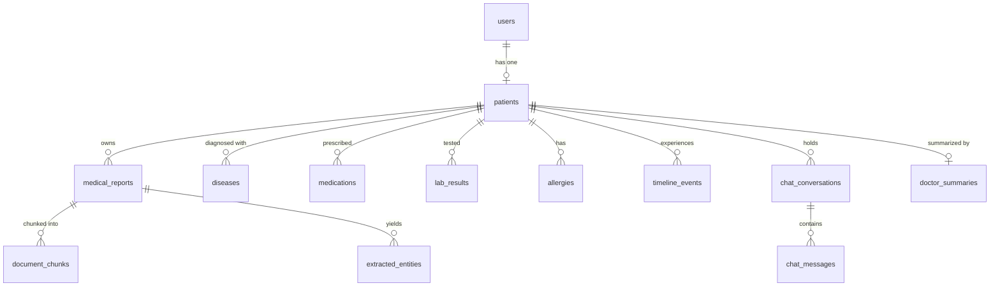

# Data Flow & Persistence Architecture — ChronaNexus

## 1. End-to-End Data Flow Overview

ChronaNexus processes healthcare information across three discrete lifecycle pathways:
1. **Document Ingestion Pathway**: Binary File -> Text & Table Extraction -> Chunking -> Vector Embedding & SQL Persistence.
2. **Clinical Memory State Merge**: Extracted Entities -> LOINC/RxNorm Canonical Resolution -> Patient Relational State Update.
3. **Conversational Intelligence & Verification Pathway**: User Query -> Query Intent Detection -> (SQL Query / Dense-Lexical Fusion RAG) -> Claim Decomposition & Verification -> Grounded Response with Citations.

---

## 2. Relational Database Schema (`chronanexus.db`)

All core application state is modeled in SQLAlchemy and mapped to relational SQLite (or PostgreSQL via `psycopg` + `pgvector`).

### Entity Relationship Diagram



### Table Definitions & Column Specifications

1. **`users`**:
   - `id` (String(36), PK): UUID identifier.
   - `email` (String(255), Unique, Indexed): User email.
   - `hashed_password` (String(255)): Bcrypt hashed secret.
   - `name` (String(255)): Full display name.
   - `role` (Enum `'patient' | 'doctor' | 'admin'`): Role for permission boundaries.
   - `is_active` (Boolean), `created_at`, `updated_at` (DateTime).

2. **`patients`**:
   - `id` (String(36), PK): Patient identifier.
   - `user_id` (String(36), FK -> `users.id`): Associated user.
   - `date_of_birth` (String(50)): ISO YYYY-MM-DD birthdate.
   - `gender` (Enum `'male' | 'female' | 'other'`): Gender identifier.
   - `blood_group` (String(10)): ABO/Rh blood type (e.g. `O+`).
   - `height_cm` (Float), `weight_kg` (Float): Physical metrics.
   - `primary_care_physician` (String(255)): Assigned PCP.
   - `emergency_contact` (JSON): Name, relationship, phone.
   - `insurance` (JSON): Provider, policy number, group number, validity.
   - `known_allergies` (JSON): Legacy array of allergy strings (backward-compatible).

3. **`medical_reports`**:
   - `id` (String(36), PK): Report identifier (e.g. `rep_001`).
   - `patient_id` (String(36), FK -> `patients.id`, Indexed): Owning patient.
   - `title` (String(255)): Human-readable document title.
   - `category` (Enum `'blood_report' | 'mri' | 'prescription' | 'discharge_summary' | 'other'`): Document type.
   - `file_url` (String(500)): Local file path (`uploads/{uuid}_{filename}`).
   - `file_size` (Integer): Size in bytes.
   - `hospital_name` (String(255)): Originating medical facility.
   - `doctor_name` (String(255)): Attending or prescribing physician.
   - `report_date` (String(50)): Document clinical date.
   - `status` (Enum `'processing' | 'completed' | 'error'`): Ingestion status.
   - `summary` (Text): Short executive summary of findings.
   - `confidence_score` (Float): Extraction confidence (0.0 to 1.0).
   - `raw_text` (Text): Full, untruncated extracted text.
   - `checksum` (String(64), Indexed): Binary file SHA-256 hash.
   - `content_checksum` (String(64)): Normalized clinical text SHA-256 hash.
   - `page_count` (Integer): Total pages extracted.

4. **`document_chunks`**:
   - `id` (Integer, PK): Surrogate auto-increment key.
   - `chunk_id` (String(100), Unique, Indexed): Globally unique chunk ID (`{doc_id}_chunk_{index}`).
   - `document_id` (String(36), FK -> `medical_reports.id`, Indexed): Source document.
   - `patient_id` (String(36), FK -> `patients.id`, Indexed): Owning patient.
   - `chunk_index` (Integer): Sequential position.
   - `page_number` (Integer): Source page number in document.
   - `chunk_text` (Text): Passage content.
   - `chunk_metadata` (JSON): Clinical section, table boundaries, tags.
   - `embedding_id` (String(100)): Reference to ChromaDB vector ID.

5. **`lab_results`**:
   - `id` (String(36), PK): Lab measurement identifier.
   - `patient_id` (String(36), FK -> `patients.id`, Indexed): Patient ID.
   - `test_name` (String(255), Indexed): Verbatim test name from report.
   - `canonical_name` (String(255), Indexed): Normalized LOINC name (e.g. `Potassium`).
   - `loinc_code` (String(20), Indexed): LOINC code (e.g. `2823-3`).
   - `category` (String(50)): Lipid, metabolic, CBC, thyroid, etc.
   - `value` (Float): Numerical measurement.
   - `unit` (String(50)): Unit of measurement (e.g. `mEq/L`, `mg/dL`).
   - `reference_range` (String(100)): Reporting lab's reference interval.
   - `status` (Enum `'normal' | 'high' | 'low' | 'critical'`): Range compliance.
   - `test_date` (String(50)): Date test was performed.
   - `hospital_name` (String(255)): Testing laboratory facility.
   - `source_report_id` (String(36), FK -> `medical_reports.id`): Source document.
   - `source_page_number` (Integer): Exact page where measurement appears.
   - `extraction_confidence` (Float): Confidence score.

6. **`allergies`**:
   - `id` (String(36), PK): Structured allergy ID.
   - `patient_id` (String(36), FK -> `patients.id`, Indexed): Patient.
   - `allergen` (String(255), Indexed): Allergen name (e.g. `Penicillin`).
   - `allergen_type` (Enum `'medication' | 'food' | 'environmental'`): Type.
   - `severity` (Enum `'mild' | 'moderate' | 'severe' | 'life_threatening'`): Severity.
   - `reaction` (String(255)): Clinical reaction (e.g. `Anaphylaxis`, `Urticaria`).
   - `drug_class` (String(100)): Drug class (e.g. `beta_lactam_antibiotics`).
   - `cross_reactivities` (JSON): Known cross-reacting agents.
   - `status` (Enum `'active' | 'inactive' | 'resolved'`): Clinical status.
   - `source_report_id` (String(36), FK -> `medical_reports.id`): Provenance.

7. **`medications`**, **`diseases`**, **`timeline_events`**, **`chat_conversations`**, **`chat_messages`**, **`doctor_summaries`**.

---

## 3. Vector Database Architecture (ChromaDB)

- **Persistence Directory**: `data/chroma_db/`
- **Active Collection Name**: `chronanexus_clinical_chunks`
- **Embedding Model**: `BAAI/bge-small-en-v1.5` (384 dimensions, cosine distance metric)
- **Metadata Fields Stored per Vector**:
  ```json
  {
    "chunk_id": "rep_001_chunk_0",
    "document_id": "rep_001",
    "patient_id": "p_9042",
    "chunk_index": 0,
    "page_number": 1,
    "clinical_section": "LABORATORY RESULTS",
    "hospital_name": "Metro General Hospital",
    "report_date": "2026-06-15"
  }
  ```
- **Patient Isolation Filter**: Every dense query strictly enforces `where={"patient_id": patient_id}`, preventing cross-tenant data access at the vector index level.

---

## 4. External Data Sources & Services

| External Dependency | Purpose | Connection Protocol | Offline Behavior |
|---|---|---|---|
| **Ollama SLM** (`llama3.2:3b`) | Narrative reasoning & generation | HTTP POST `http://localhost:11434/api/generate` | Propagates `OllamaServiceError` (`reasoning_type="error"`), suppresses citations; or uses `MockDeterministicLLMProvider` in automated offline tests |
| **BGE Embedding Model** | Dense semantic representation | Local HuggingFace cache (`~/.cache/huggingface`) | 100% offline; runs locally via PyTorch / Sentence-Transformers on CPU |
| **Local File System** | Storage of uploaded PDF files | OS file I/O in `uploads/` directory | Always local; path stored in `medical_reports.file_url` |
