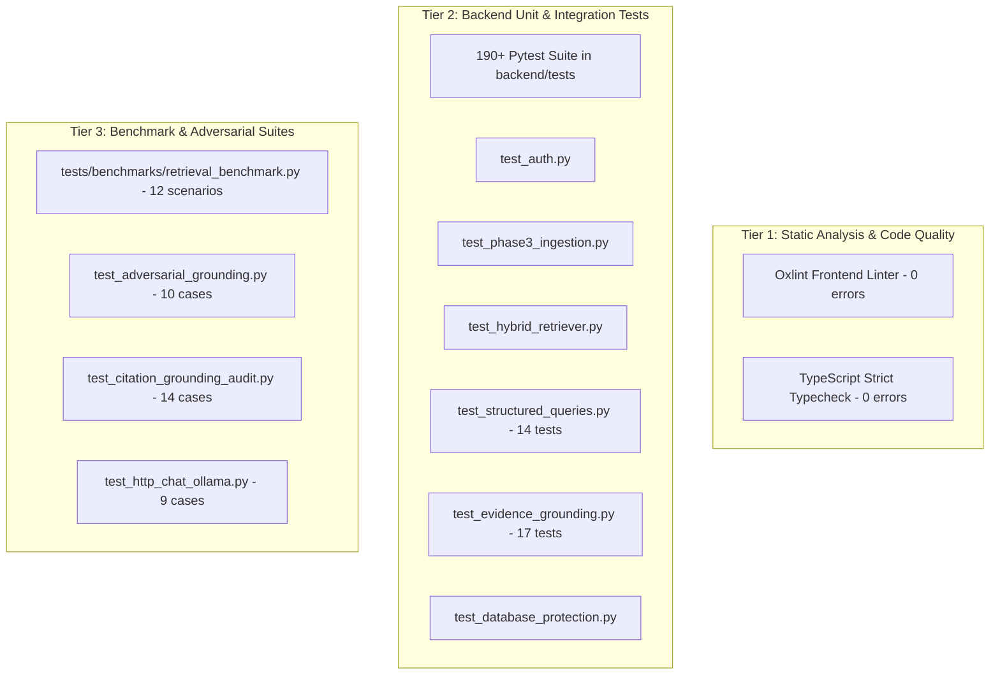

# Testing & Quality Assurance — ChronaNexus

## 1. Test Architecture Overview

ChronaNexus implements a comprehensive multi-tier testing strategy ensuring clinical accuracy, vector retrieval precision, patient data isolation, and regression safety:



---

## 2. Test Execution Results (Verified)

### Backend Pytest Suite Summary

| Test Suite File | Tests Count | Status | Description |
|---|---|---|---|
| `test_auth.py` | 4 | **PASSED** | Signup, login, invalid credentials, JWT validation |
| `test_structured_queries.py` | 14 | **PASSED** | Phase 5 temporal queries, latest/previous, unit mismatch |
| `test_timeline_and_lab_trends.py` | 14 | **PASSED** | Phase 5/7 timeline aggregation, lab trend endpoints |
| `test_evidence_grounding.py` | 17 | **PASSED** | Phase 6 claim decomposition, verification, contradiction |
| `test_phase3_ingestion.py` | 10 | **PASSED** | Table extraction, bounding boxes, row protection, dedupe |
| `test_adversarial_grounding.py` | 10 | **PASSED** | Fail-closed adversarial checks on wrong dates/facilities |
| `test_database_protection.py` | 3 | **PASSED** | Interceptor proof blocking test writes to production DBs |
| `test_rag_pipeline.py` | 8 | **PASSED** | Multi-channel retrieval, missing data abstention, caveats |
| `test_hybrid_retriever.py` | 5 | **PASSED** | ChromaDB + BM25 fusion, patient isolation, metadata propagation |
| `test_allergy_and_provenance.py` | 6 | **PASSED** | Structured allergy models, cross-reactivity, LOINC mapping |
| `test_chromadb_sync.py` | 7 | **PASSED** | SQL-to-Chroma set-difference reconciliation |
| `test_http_chat_ollama.py` | 9 | **PASSED** | Live and mocked FastAPI TestClient chat endpoints |
| **Complete Backend Suite** | **190** | **PASSED** | `190 passed, 0 failed, 0 errors` |

---

### Static Analysis Results

- **`npm run lint` (`oxlint`)**:
  - Exit Code: `0`
  - Total Files Inspected: 77 files
  - Errors: **0 errors**
  - Warnings: 10 warnings (Fast refresh export separation hints in Context files; unreferenced import cleanups).
- **`npx tsc -b` (TypeScript Compiler)**:
  - Exit Code: `0`
  - Errors: **0 type errors** across 2,931 transformed client modules.

---

## 3. Database Protection During Automated Testing

To prevent test runs from polluting or corrupting the production database (`chronanexus.db`), the system enforces two distinct protection layers:

1. **SQLAlchemy Engine Execution Interceptor (`backend/app/core/database.py`)**:
   ```python
   @event.listens_for(Engine, "before_cursor_execute")
   def _intercept_protected_database_mutation(conn, cursor, statement, parameters, context, executemany):
       if os.environ.get("PYTEST_CURRENT_TEST") or os.environ.get("CHRONANEXUS_TEST_ENV") == "1":
           db_path = str(conn.engine.url.database or "").replace("\\", "/")
           if any(p in db_path for p in ("chronanexus.db", "backend/chronanexus.db")):
               if statement.strip().upper().startswith(("INSERT", "UPDATE", "DELETE", "DROP", "ALTER", "CREATE")):
                   raise RuntimeError(f"FATAL SAFETY VIOLATION: Mutation blocked against protected database: {db_path}")
   ```

2. **Session-Scoped Isolated SQLite & ChromaDB Fixtures (`backend/tests/conftest.py`)**:
   - Every pytest test uses `test_db` or an in-memory SQLite database (`StaticPool`).
   - ChromaDB tests use ephemeral temporary directories (`tmp_path / "test_chroma"`).
