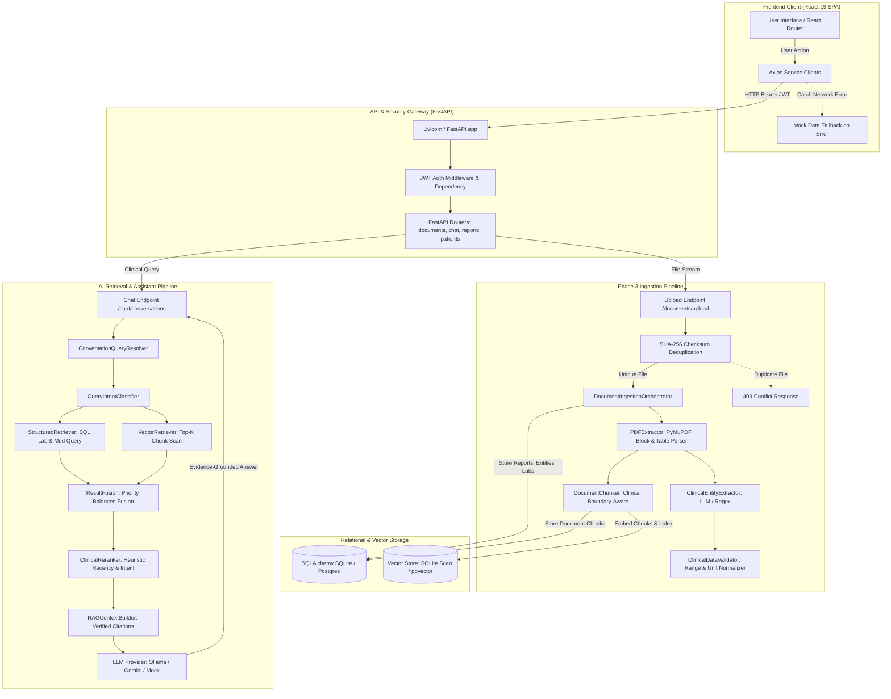
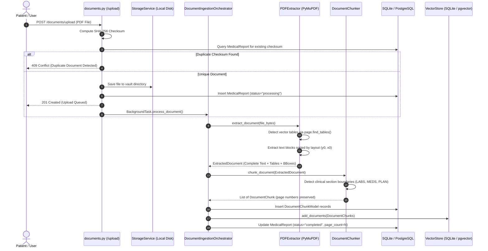
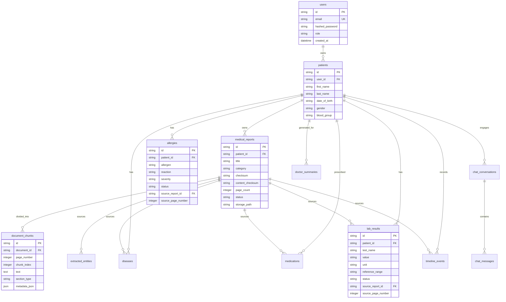
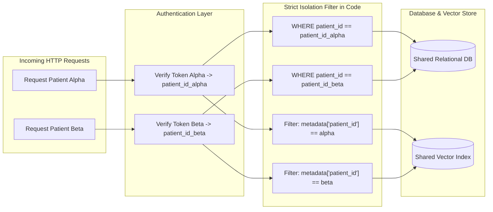
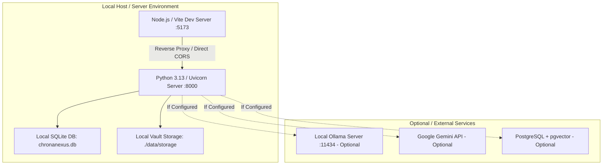
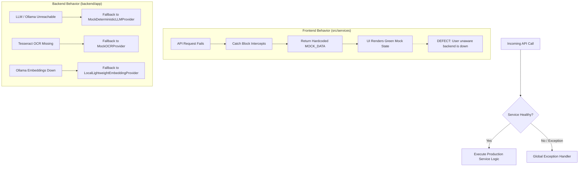

# ChronaNexus Forensic Audit Dossier ? Complete System Architecture

**Document ID:** `03_COMPLETE_SYSTEM_ARCHITECTURE.md`  
**Audit Standard:** Zero-Fabrication Forensic Audit  
**Date of Execution:** 2026-10-18T17:30:00+05:30  

---

## 1. End-to-End System Architecture Trace

The following diagram represents the actual execution flow traced across the codebase:

---

## 2. Ingestion & Extraction Architecture Trace

The document ingestion pipeline processes clinical PDFs from upload to relational and vector storage without arbitrary text truncation.

---

## 3. Database Entity-Relationship Model (14 Tables)

---

## 4. Patient Isolation Boundaries & Data Flow

---

## 5. Deployment and Runtime Dependencies

---

## 6. Error Handling & Fallback Paths

