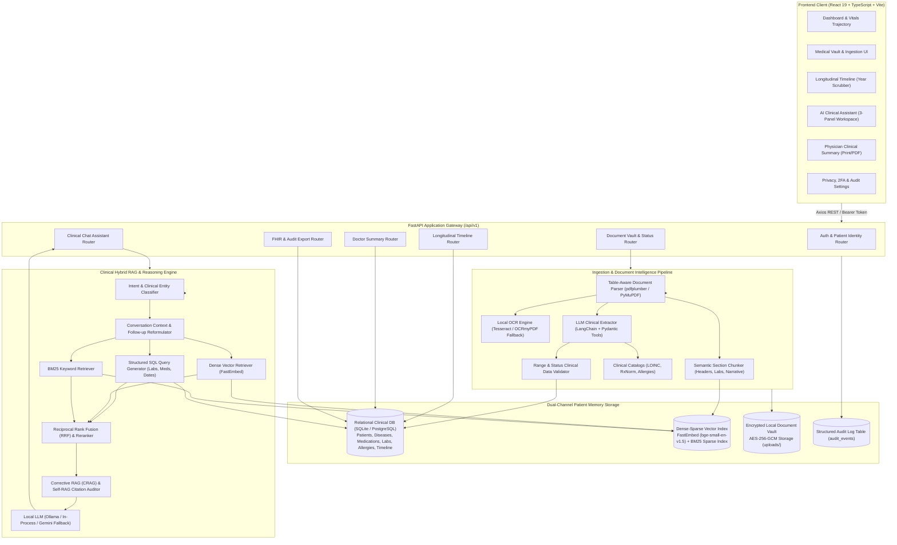
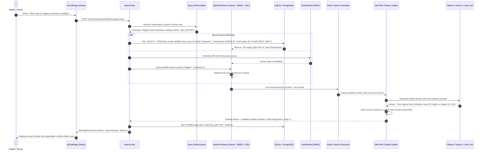

# ChronaNexus — Target System Architecture Specification

> **Document ID:** `05_TARGET_ARCHITECTURE.md`  
> **Source Documents:** `01_CURRENT_STATE_AUDIT.md`, `02_REPOSITORY_DEEP_ANALYSIS.md`, `04_INTEGRATION_OPTIONS.md`  
> **Date:** 2026-10-17  
> **Author:** Principal Software Architect & AI Systems Engineer  
> **Status:** Authoritative Target Architecture  

---

## 1. System Vision & Architecture Principles

ChronaNexus is engineered as a **privacy-first, longitudinal medical intelligence platform**. It converts fragmented medical PDF documents, clinical encounters, and laboratory reports into an intelligent, structured patient health memory.

The target architecture is governed by five non-negotiable principles:
1. **Local-First & Zero Data Leakage:** Core parsing, vector embeddings, and retrieval run 100% on-device. Health data never leaves the patient's machine unless explicitly configured by the user.
2. **Dual-Channel Clinical Memory:** Exact numbers, dates, and medication dosages are retrieved via deterministic SQL queries over structured relational tables; narrative context and clinical impressions are retrieved via dense-sparse semantic search.
3. **Evidence-Grounded Attribution:** Every AI response must cite verified source documents with page numbers and snippet provenance. If records contain no relevant information, the system explicitly reports missing data and suppresses unrelated citations.
4. **Clean Monolithic Simplicity:** Avoids multi-container microservice sprawl. Runs cleanly inside the existing React 19 + FastAPI framework.
5. **Permissive Open-Source Foundation:** Sourced strictly under **Apache-2.0** and **MIT** licenses.

---

## 2. High-Level Component Architecture

---

## 3. Subsystem Specifications

### 3.1 Frontend & API Boundaries
- **Retained from ChronaNexus:** The complete React 19 frontend design system (`src/`), Apple Health design tokens, 3-panel chat workspace (`AIChatPage.tsx`), Year-Scrubber timeline (`TimelinePage.tsx`), and Axios client (`services/axios.ts`).
- **Target Enhancements:**
  1. Add TypeScript definitions from `@medplum/fhirtypes` for full FHIR resource validation.
  2. Connect `VitalsTrendChart.tsx` to the new longitudinal biomarker time-series API route.
  3. Wire the Security & 2FA panel in `SettingsPage.tsx` to the new `auth_session` and `audit_events` endpoints.

### 3.2 Document Ingestion, Parsing & OCR
- **Replaced Component:** The fragile `pypdf` text reader in `backend/app/ai/extractors/pdf_extractor.py` and silent-failing OCR in `backend/app/ai/ocr/tesseract.py`.
- **Target Implementation (Adapted from Paperless-ngx & RAGFlow DeepDoc):**
  1. **Layout & Table Extraction:** Integrate `pdfplumber` for table boundary detection. Medical reports with tabular lab test results (Test Name, Result, Flag, Unit, Reference Range) are extracted as structured markdown tables rather than flattened text streams.
  2. **Scanned PDF Normalization:** Integrate OCRmyPDF / PyMuPDF to deskew, detect rotation, and generate high-fidelity search text for scanned prescriptions and discharge slips.
  3. **Full Document Processing:** Remove the arbitrary 3,000-character truncation in `LLMClinicalExtractor`. Multi-page documents are parsed page-by-page.

### 3.3 Clinical Fact Extraction & Ontology Catalog
- **Replaced Component:** The 9-item hardcoded regex in `RuleBasedClinicalExtractor` and static taxonomy dictionaries in `classifier.py` and `query_resolver.py`.
- **New Adopted Component (Adapted from Health Assistant under Apache-2.0):**
  1. **Standardized Clinical Catalogs:** Import Health Assistant's seed catalogs (`backend/data/seeds/biomarker_panels.json`, `allergies.json`, `clinical_event_types.json`) into `backend/app/data/seeds/`.
  2. **Allergy Domain Model:** Create a first-class `AllergyIntolerance` SQLAlchemy model (`id`, `patient_id`, `substance`, `reaction`, `severity`, `verification_status`) replacing the static JSON array on `Patient`.
  3. **Dynamic Alias Resolution:** Clinical lab tests (e.g. "HbA1c", "Hemoglobin A1c", "Glycated Hemoglobin", "A1c") and lipid panels ("Total Cholesterol", "LDL-C", "Triglycerides") are linked via canonical LOINC codes and alias sets.
  4. **Automatic Timeline Synthesis:** The ingestion orchestrator automatically generates `TimelineEvent` records whenever an uploaded report contains a diagnosis date, medication start date, or surgical procedure.

### 3.4 Dual-Channel Retrieval Engine (Dense + Sparse + Structured)
- **Replaced Component:** The SHA-256 token-hash pseudo-embeddings in `LocalLightweightEmbeddingProvider` and SQLite Python table-scan loop in `retrieval.py`.
- **Target Implementation (Adapted from Health Assistant & RAGFlow):**
  1. **Embedded Neural Embedder (`fastembed`):** Use `fastembed` with `BAAI/bge-small-en-v1.5` (384 dimensions, Apache-2.0). Runs in-process on CPU via ONNX Runtime with zero external services and executes in milliseconds. Provides true semantic vector similarity out of the box.
  2. **BM25 Sparse Retrieval:** Integrate Okapi BM25 keyword retrieval (adapted from RAGFlow `internal/agentic_rag/bm25_service.go`) to guarantee exact matching for rare drug names, ICD-10 codes, and clinical numbers.
  3. **Reciprocal Rank Fusion (RRF):** Combine dense vector candidates, BM25 keyword candidates, and structured SQL records using standard Reciprocal Rank Fusion:
     $$RRF(d) = \sum_{m \in M} \frac{w_m}{k + r_m(d)}$$
     where $k=60$ and $w_m$ weights channel confidence.
  4. **Structured SQL Retrieval:** Numerical extremum queries ("highest cholesterol", "latest HbA1c", "blood pressure in 2023") bypass fuzzy vector search and query `lab_results` and `medications` directly using SQL `ORDER BY value DESC` and `ORDER BY test_date DESC`.

### 3.5 Evidence Selection, Guardrails & Citation Verification
- **Replaced Component:** The naive regex-based citation suppressor in `pipeline.py:L226-L256`.
- **New Adopted Component (Adapted from ArogyaSutra DoJ under MIT):**
  1. **Self-Reflective RAG (Self-RAG):** Evaluates candidate answer sentences against the retrieved document chunks. If a statement cannot be grounded in the cited snippet, it is discarded or flagged as an inference.
  2. **Missing Data Honesty:** When a user queries a topic not present in the medical records (e.g. "what is my kidney function?" when no creatinine/eGFR exists), the system generates an explicit disclaimer: *"Your uploaded medical records do not contain kidney function tests."* Any unrelated retrieved chunks (e.g. knee MRI or HbA1c) are strictly suppressed from citations.

### 3.6 Longitudinal Trend Analytics & Doctor Summary
- **Target Implementation (Adapted from Health Assistant `analytics_service.py`):**
  1. **Biomarker Trajectory Service:** Groups historical lab results by LOINC code and test date, calculates percentage change from baseline, identifies out-of-range anomalies, and serves clean time-series JSON to `VitalsTrendChart.tsx`.
  2. **Dynamic Doctor Summary:** `summary_service.py` calculates patient age dynamically from `date_of_birth`, resolves active conditions from `diseases`, populates actual drug allergies from `AllergyIntolerance`, and computes clinical cardiovascular/metabolic risk flags dynamically.

### 3.7 Privacy, Audit Logging & Data Export
- **New Component:**
  1. **Audit Logging:** An `audit_events` table (`id`, `patient_id`, `timestamp`, `event_type`, `resource_id`, `ip_address`, `details`) recording all document uploads, deletes, AI queries, and data exports.
  2. **FHIR R4 Export:** A one-click export endpoint producing a standard FHIR R4 Bundle JSON containing the patient's entire longitudinal history (Patient, Conditions, Observations, MedicationRequests, Allergies).

---

## 4. End-to-End Clinical Query Data Flow

---

## 5. Summary of Component Lifecycle Decisions

| Component Name | Status | Justification & Architectural Evidence |
|---|---|---|
| **ChronaNexus Frontend UI** | **RETAIN** | Clean, accessible, responsive Apple Health UI. Zero defects in visual layer. |
| **FastAPI Route Structure** | **RETAIN** | Well-designed REST contract. Endpoints match frontend client requirements. |
| **`LocalLightweightEmbeddingProvider`** | **REPLACE** | Replaced by `fastembed` (BGE-small-en-v1.5). Eliminates SHA-256 token hash collision defect. |
| **`pypdf` Text Reader** | **REPLACE** | Replaced by `pdfplumber` + PyMuPDF. Eliminates multi-column and table flattening defect. |
| **Static Keyword Taxonomy Sets** | **REPLACE** | Replaced by Health Assistant's LOINC seed catalogs and dynamic query reformulation. |
| **`AllergyIntolerance` Table** | **NEW ADOPTION** | Replaces static JSON array on `Patient`. Sourced from Health Assistant schema. |
| **Corrective RAG (CRAG) & Self-RAG** | **NEW ADOPTION** | Adapted from ArogyaSutra (DoJ) to eliminate ungrounded citations. |
| **Biomarker Trajectory Analytics** | **NEW ADOPTION** | Adapted from Health Assistant `analytics_service.py` to power `VitalsTrendChart`. |
| **Audit Logging (`audit_events`)** | **NEW ADOPTION** | Adapted from Health Assistant `audit_model.py` for HIPAA/GDPR auditability. |
| **OHIF Viewer & Orthanc** | **DEFER** | Deferred to Phase 4. MVP handles document reports, not raw DICOM series. |
| **OpenMRS & GNU Health** | **DEFER / REJECT** | Stack incompatibility (Java/Tryton). Kept as conceptual reference only. |
| **Paperless-ngx / RAGFlow Containers**| **REJECT** | Avoids multi-container infrastructure bloat. We adapt their algorithms natively instead. |
