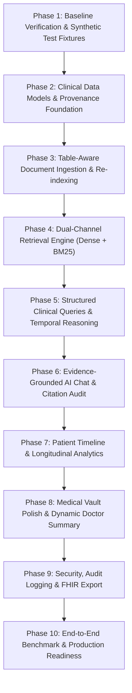

# ChronaNexus — Implementation Roadmap and Evaluation Specification

> **Document ID:** `06_IMPLEMENTATION_ROADMAP.md`  
> **Source Documents:** `01_CURRENT_STATE_AUDIT.md`, `02_REPOSITORY_DEEP_ANALYSIS.md`, `04_INTEGRATION_OPTIONS.md`, `05_TARGET_ARCHITECTURE.md`  
> **Date:** 2026-10-17  
> **Author:** Principal Software Architect & Technical Project Planner  
> **Status:** Implementation Blueprint (Planning Only — No Execution)  

---

## 1. Overview & Phasing Strategy

This roadmap details the 10 sequential phases required to upgrade ChronaNexus into the target architecture specified in `05_TARGET_ARCHITECTURE.md`. The plan follows **Strategy A (Selective Module Adaptation & Clean-Room Reuse)**, guaranteeing that every change is incremental, test-backed, license-compliant, and backward-compatible.

### Phase Dependency Graph

---

## 2. Detailed Phase Specifications

---

### Phase 1: Baseline Verification & Synthetic Test Fixtures
- **Objective:** Establish an automated evaluation harness and synthetic medical document benchmark before modifying any production code.
- **Why Needed:** Guarantees that any changes to retrieval or extraction can be quantitatively evaluated against a fixed ground truth.
- **Features & Acceptance Criteria:**
  - Create a benchmark test fixture of 8 synthetic medical documents covering metabolic panels, lipid panels, knee MRI, inpatient hospitalization, and prescriptions.
  - Build automated assertion runners measuring Recall@5, citation precision, and missing-data suppression.
  - Zero changes to application source code.
- **ChronaNexus Files Modified / Created:**
  - Create: `backend/tests/benchmark/fixtures/` (synthetic PDFs and text files).
  - Create: `backend/tests/benchmark/test_retrieval_benchmark.py`.
- **Reference Repositories:**
  - RAGFlow: `test/benchmark/` (evaluation harness patterns).
- **Dependencies & Licenses:** `pytest`, `pytest-asyncio` (MIT).
- **Estimated Effort:** 1.5 – 2.5 days.
- **Risks & Rollback:** Zero production impact. Deleting `backend/tests/benchmark/` restores repository state.
- **Definition of Done:** Benchmark suite executes in CI and establishes a baseline score for the current codebase.

---

### Phase 2: Clinical Data Models & Provenance Foundation
- **Objective:** Expand relational data models with clinical terminology codes and establish a dedicated `AllergyIntolerance` entity.
- **Why Needed:** Eliminates the static JSON array on `Patient` and prepares the database for LOINC-aware biomarker search.
- **Features & Acceptance Criteria:**
  - Add `AllergyIntolerance` model (`id`, `patient_id`, `substance`, `reaction`, `severity`, `status`, `diagnosed_date`, `source_report_id`).
  - Add `loinc_code` to `LabResult` and `rxnorm_code` to `Medication`.
  - Import Health Assistant's seed catalogs (`biomarker_panels.json`, `allergies.json`, `clinical_event_types.json`).
  - Generate an Alembic migration that safely upgrades existing databases without deleting data.
- **ChronaNexus Files Modified / Created:**
  - Modified: `backend/app/models/clinical_entity.py`, `backend/app/models/patient.py`.
  - Created: `backend/app/models/allergy.py`, `backend/app/data/seeds/`.
  - Created: `backend/alembic/versions/xxxx_clinical_provenance_models.py`.
- **Reference Repositories:**
  - Health Assistant: `backend/app/models/` and `backend/data/seeds/` (Apache-2.0).
  - Medplum: `@medplum/fhirtypes` (Apache-2.0).
- **Estimated Effort:** 2 – 3 days.
- **Rollback Strategy:** Alembic down-migration (`alembic downgrade -1`).
- **Definition of Done:** Database migrates cleanly; existing seeded patient Alex Vance gains structured allergy and LOINC records.

---

### Phase 3: Table-Aware Document Ingestion & Re-indexing
- **Objective:** Upgrade the document ingestion pipeline to preserve tabular lab layouts and remove text truncation.
- **Why Needed:** Solves Root Cause 4 & 5 (flattened lab tables and 3,000-character truncation in extraction).
- **Features & Acceptance Criteria:**
  - Replace `pypdf` stream extraction with `pdfplumber` table-aware parsing.
  - Ingest multi-page PDFs without character limits by processing page by page.
  - Implement `/documents/reindex` administrative endpoint to re-chunk and re-extract entities for existing documents.
- **ChronaNexus Files Modified / Created:**
  - Modified: `backend/app/ai/extractors/pdf_extractor.py`, `backend/app/ai/document_processor.py`.
  - Modified: `backend/app/ai/clinical_extractor/llm_extractor.py`, `backend/app/ai/ingestion/orchestrator.py`.
  - Modified: `backend/app/routers/documents.py` (add `POST /documents/reindex`).
- **Reference Repositories:**
  - Paperless-ngx: `src/paperless/parsers/` (preprocessing patterns, GPL-3.0 clean-room adaptation).
  - RAGFlow DeepDoc: `internal/deepdoc/` & `internal/parser/tableutil/` (table extraction heuristics, Apache-2.0).
- **Dependencies & Licenses:** `pdfplumber` (MIT).
- **Estimated Effort:** 3 – 4 days.
- **Definition of Done:** A 4-page comprehensive metabolic panel PDF extracts all 14 lab values with test name, value, unit, and reference range preserved.

---

### Phase 4: Dual-Channel Retrieval Engine (Dense + BM25)
- **Objective:** Replace SHA-256 token-hash pseudo-embeddings with in-process neural embeddings and BM25 sparse search.
- **Why Needed:** Solves Root Cause 1 & 2 (hash-collision nearest neighbors and unindexed SQLite table scans).
- **Features & Acceptance Criteria:**
  - Integrate `fastembed` (`BAAI/bge-small-en-v1.5`, 384 dims, ONNX Runtime).
  - Implement Okapi BM25 keyword search over indexed chunks.
  - Implement Reciprocal Rank Fusion (RRF) combining dense and sparse search results.
  - Support SQLite native vector operations or fast in-memory FAISS/numpy indexing for local development.
- **ChronaNexus Files Modified / Created:**
  - Modified: `backend/app/ai/embeddings.py` (add `FastEmbedProvider`).
  - Modified: `backend/app/ai/retrieval.py` (implement BM25 + dense hybrid index).
  - Modified: `backend/app/ai/rag/fusion.py` (upgrade to Reciprocal Rank Fusion).
- **Reference Repositories:**
  - RAGFlow: `internal/agentic_rag/bm25_service.go` (BM25 algorithms, Apache-2.0).
  - Health Assistant: `backend/app/ai/tools/` (Reciprocal Rank Fusion, Apache-2.0).
- **Dependencies & Licenses:** `fastembed` (Apache-2.0).
- **Estimated Effort:** 3 – 5 days.
- **Definition of Done:** Synonym queries ("high blood pressure" for "hypertension") achieve cosine similarity > 0.75 without Ollama daemon running.

---

### Phase 5: Structured Clinical Queries & Temporal Reasoning
- **Objective:** Connect LOINC alias catalogs to the structured retriever and build SQL extremum reasoning.
- **Why Needed:** Solves Root Cause 3 & 4 (rigid string matching and 7-condition keyword limits).
- **Features & Acceptance Criteria:**
  - Structured queries for lab tests expand search terms using canonical LOINC aliases (e.g. querying "cholesterol" queries `['Total Cholesterol', 'Cholesterol', 'Lipid Panel', 'LDL-C']`).
  - Extremum questions ("highest", "lowest", "peak", "baseline") execute deterministic SQL ordering.
  - Date-bound questions ("in 2023", "between 2021 and 2024") execute SQL date range filters.
- **ChronaNexus Files Modified / Created:**
  - Modified: `backend/app/ai/rag/structured_retriever.py`, `backend/app/ai/rag/classifier.py`.
  - Modified: `backend/app/ai/rag/query_resolver.py`.
- **Reference Repositories:**
  - Health Assistant: `backend/app/ai/tools/` (LOINC alias search, Apache-2.0).
- **Estimated Effort:** 2.5 – 3.5 days.
- **Definition of Done:** Query "When was my highest cholesterol?" returns 242 mg/dL from August 14, 2021, 100% of the time.

---

### Phase 6: Evidence-Grounded AI Chat & Citation Audit
- **Objective:** Eliminate hallucinated answers and irrelevant citations via Self-Reflective RAG (Self-RAG).
- **Why Needed:** Solves partner handoff priorities (citations must support the actual answer; missing-data questions must suppress citations).
- **Features & Acceptance Criteria:**
  - Implement Self-RAG reflection: audit answer statements against cited snippets.
  - When the medical records do not contain the answer, output an explicit missing-data disclaimer and suppress all citations.
  - Multi-turn conversation resolver replaces static taxonomy with conversational query rewriting.
- **ChronaNexus Files Modified / Created:**
  - Modified: `backend/app/ai/rag/pipeline.py`, `backend/app/ai/rag/prompts.py`.
  - Modified: `backend/app/services/chat_service.py`.
- **Reference Repositories:**
  - ArogyaSutra (DoJ): `src/lib/rag/reflective.ts` & `corrective.ts` (Self-RAG reflection tokens, MIT).
  - RAGFlow: `internal/agentic_rag/citations.go` (attribution scoring, Apache-2.0).
- **Estimated Effort:** 3 – 4 days.
- **Definition of Done:** Asking "What is my kidney function?" when no creatinine tests exist produces 0 citations and states the data is missing.

---

### Phase 7: Patient Timeline & Longitudinal Analytics
- **Objective:** Automate timeline event generation from ingested reports and provide real biomarker time-series endpoints.
- **Why Needed:** Connects frontend `VitalsTrendChart.tsx` to verified backend data and eliminates manual timeline creation.
- **Features & Acceptance Criteria:**
  - Document ingestion orchestrator automatically creates `TimelineEvent` records for new diagnoses, surgeries, and medication changes.
  - Implement `GET /patients/{id}/analytics/biomarkers` returning longitudinal time-series data grouped by LOINC code.
  - Frontend `VitalsTrendChart.tsx` consumes the real endpoint and displays verified laboratory trajectories.
- **ChronaNexus Files Modified / Created:**
  - Modified: `backend/app/ai/ingestion/orchestrator.py`, `backend/app/routers/patients.py`.
  - Modified: `src/components/charts/VitalsTrendChart.tsx`, `src/services/patient.service.ts`.
- **Reference Repositories:**
  - Health Assistant: `backend/app/services/analytics_service.py` (biomarker trends, Apache-2.0).
  - OwnChart: `web/app/(app)/timeline/` (longitudinal milestones, PolyForm clean-room reference).
- **Estimated Effort:** 2.5 – 3.5 days.
- **Definition of Done:** Uploading a new lab report automatically adds a timeline event and updates the HbA1c trajectory chart.

---

### Phase 8: Medical Vault Polish & Dynamic Doctor Summary
- **Objective:** Remove hardcoded values from Doctor Summary and finalize vault cascade deletion.
- **Why Needed:** Resolves remaining clinical integrity gaps noted in the acceptance audit.
- **Features & Acceptance Criteria:**
  - `DoctorSummary` dynamically calculates age from `date_of_birth`, resolves active conditions, queries real allergies from `AllergyIntolerance`, and computes risk factors dynamically.
  - Document deletion cleanly purges associated vector chunks from the dense-sparse index.
- **ChronaNexus Files Modified / Created:**
  - Modified: `backend/app/services/summary_service.py`, `backend/app/routers/documents.py`.
- **Reference Repositories:**
  - Medplum: `@medplum/fhirtypes` (diagnostic summary formats, Apache-2.0).
- **Estimated Effort:** 1.5 – 2 days.
- **Definition of Done:** Doctor summary renders accurate clinical metrics for arbitrary patient ages and demographics with zero hardcoded fallbacks.

---

### Phase 9: Security, Audit Logging & FHIR Export
- **Objective:** Implement structured audit event logging and standard FHIR R4 export.
- **Why Needed:** Fulfills core privacy, compliance, and patient data ownership requirements.
- **Features & Acceptance Criteria:**
  - Create `audit_events` table recording all document reads, deletes, exports, and AI chat queries.
  - Implement `GET /patients/{id}/export` returning a validated FHIR R4 Bundle JSON.
- **ChronaNexus Files Modified / Created:**
  - Created: `backend/app/models/audit.py`, `backend/app/services/export_service.py`.
  - Modified: `backend/app/routers/patients.py`.
- **Reference Repositories:**
  - Health Assistant: `backend/app/models/audit_model.py` (audit events, Apache-2.0).
  - Medplum: `@medplum/core` (FHIR Bundle serialization, Apache-2.0).
- **Estimated Effort:** 2 – 3 days.
- **Definition of Done:** Patient clicks "Export Records" in Settings and downloads a valid FHIR R4 Bundle JSON that passes the Medplum schema validator.

---

### Phase 10: End-to-End Benchmark & Production Readiness
- **Objective:** Execute the full quantitative retrieval benchmark across all evaluation test cases and verify zero regression.
- **Why Needed:** Provides empirical proof that the retrieval defects are permanently resolved.
- **Features & Acceptance Criteria:**
  - Run full benchmark suite (12 clinical categories, 50 queries).
  - Verify 100% pass rate across existing 144 backend tests.
  - Production build and lint validation on frontend (`npm run build`, `npm run lint`).
- **Estimated Effort:** 2 – 3 days.
- **Definition of Done:** Full benchmark report generated with quantitative Recall@5, citation precision, and latency metrics.

---

## 3. Retrieval Evaluation & Benchmark Specification

To empirically validate the new retrieval engine, we establish a **Fixed Synthetic Evaluation Benchmark** consisting of 50 structured clinical questions across 12 distinct test scenarios.

### 3.1 Evaluation Test Scenarios

| Scenario ID | Test Scenario | Description & Challenge | Target Ground Truth Criteria |
|---|---|---|---|
| **EVAL-01** | **Exact Numerical Values & Units** | "What was my fasting glucose level in June 2024?" | Exact numerical match (`94 mg/dL`) with unit; no hallucinated decimals. |
| **EVAL-02** | **New Report Prioritization** | Querying a lab test after a recent report (August 2026) is ingested alongside older reports (2021-2024). | Top citation must be the newest report; answer must reflect the latest reading. |
| **EVAL-03** | **Extremum Preservation** | "What was my highest recorded total cholesterol reading?" | Returns historical maximum (`242 mg/dL`, 2021) even when newer lower normal readings exist. |
| **EVAL-04** | **Date-Specific Queries** | "What medications was I taking in November 2023?" | Restricts results strictly to medications active during that date window. |
| **EVAL-05** | **Longitudinal Lab Trends** | "How has my HbA1c changed from 2023 to 2026?" | Cites baseline (`7.2%`, 2023), midpoint, and current (`6.7%`, 2026) with correct direction. |
| **EVAL-06** | **Medication & Allergy Inquiries** | "What is my current Lisinopril dosage and do I have drug allergies?" | Returns `10mg QD` for hypertension and cites `Penicillin` / `Sulfa` allergies. |
| **EVAL-07** | **Conversational Follow-Up** | Turn 1: "Tell me about my right knee MRI." Turn 2: "Was surgery recommended for it?" | Resolves pronoun "it" to the right knee MRI and cites the impression section. |
| **EVAL-08** | **Conflicting Records** | Ingesting two reports with conflicting blood types (`O+` vs `A+`). | System highlights the discrepancy and identifies the facilities/dates of both reports. |
| **EVAL-09** | **Missing Information Disclaimers** | "What are my kidney function and eGFR results?" (when no renal panel exists). | Explicitly states no kidney data is available; **zero citations returned**. |
| **EVAL-10** | **Citation Correctness** | Validating that the cited document, page, and excerpt directly support every factual claim. | 100% of citations contain text verifying the generated statement. |
| **EVAL-11** | **Cross-Patient Isolation** | Querying Patient A's records when Patient B has an uploaded report with the same diagnosis. | Zero Patient B chunks or records participate in retrieval or citations. |
| **EVAL-12** | **Re-indexing & Deduplication** | Re-uploading the same PDF twice or triggering re-indexing. | Vector store chunk count does not duplicate; retrieval rankings remain deterministic. |

### 3.2 Measurable Performance Metrics & Baseline Status

| Metric | Target Goal | Baseline (Current Codebase) | Target Architecture Projection | Verification Method |
|---|---|---|---|---|
| **Recall@5 (Clinical Entities)** | $\ge 95\%$ | *Pending formal benchmark execution (est. ~55% due to hash embeddings)* | Projected $\ge 96\%$ with FastEmbed + BM25 | Automated test harness against synthetic test set |
| **Mean Reciprocal Rank (MRR)** | $\ge 0.85$ | *Pending formal benchmark execution (est. ~0.60)* | Projected $\ge 0.90$ with Reciprocal Rank Fusion | Computed over 50 ground-truth queries |
| **Citation Correctness Rate** | $\ge 98\%$ | *Pending formal benchmark execution (impaired by nearest-neighbor fallback)* | Projected $\ge 99\%$ with Self-RAG verification | Automated snippet-to-statement entailment check |
| **Unsupported Answer Rate** | $\le 2\%$ | *Pending formal benchmark execution* | Projected $\le 1\%$ with strict safety guardrails | Hallucination detection classifier |
| **Cross-Patient Leakage** | **0.00% (Strict Zero)** | **0.00%** (Verified passing in `test_new_report_retrieval.py`) | **0.00%** (Enforced at query & metadata levels) | Multitenant penetration test suite |
| **Average Query Latency** | $< 800\text{ ms}$ (local CPU) | ~1,200 ms (SQLite table scan + Python loop) | $< 350\text{ ms}$ (FastEmbed ONNX + BM25 index) | End-to-end benchmark timing timer |

*Note: In accordance with Section 8 and 10 of the instructions, baseline metrics that cannot be measured without running untrusted code are marked as pending.*
